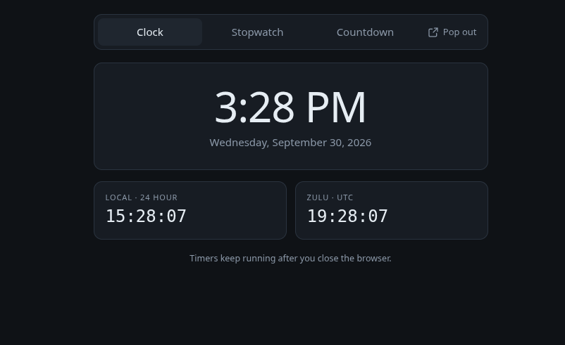

# Web Alarm

A clock, stopwatch, and countdown timer that keep running after you close the browser.

[](#hosting)
[](#why-it-is-like-this)
[](#local-development)
[](#)
[](#)
[](#)
[](#hosting)
[](#license)

Three plain files of JavaScript, one stylesheet, one HTML page. No framework, no
bundler, no package manager, no server-side code, no database, no telemetry.



---

## Features

### Clock

Local time in 12-hour form, the full written date, local 24-hour time, and
Zulu/UTC time — all updating once per second and all computed in the browser, so
the display is correct the instant the page loads.

### Stopwatch

Millisecond-resolution stopwatch with **Start / Split / Resume** and
**Stop / Clear**. Splits are recorded newest-first with both the interval since
the previous split and the running total.

### Countdown

Set hours and minutes, pick an alarm sound from the bundled MP3s, and start. The
readout shows the remaining time and the wall-clock time the timer will end at.
When it expires the panel flashes, the alarm loops until dismissed, and the
browser tab title announces it. **Restart** re-runs the same duration;
**Dismiss** silences it.

### Timers survive closing the browser

This is the point of the tool. State lives in `localStorage` and every timer is
stored as an **absolute target timestamp**, not an accumulated tick count. Close
the tab, quit the browser, come back an hour later — the stopwatch reflects the
real elapsed time and an expired countdown announces itself on arrival.

### Pop-out window

The **Pop out** button opens a small floating window you can park anywhere on
your desktop. Where the [Document Picture-in-Picture API][pip] is available this
is a genuinely chrome-less, always-on-top window; elsewhere it falls back to a
plain popup. Either way the window **resizes itself to fit whichever tab you are
on**, so there is no dead space.

### Every window stays in sync

Open the app in several tabs and the pop-out at the same time. Starting the
stopwatch in one instantly updates all the others, via the `storage` event. They
are all views onto the same state.

[pip]: https://developer.mozilla.org/en-US/docs/Web/API/Document_Picture-in-Picture_API

---

## Local development

Any static file server will do. The repository ships with a VS Code launch
configuration that starts one and opens a browser:

> **Run and Debug → Serve Web Alarm** (or press <kbd>F5</kbd>)

Or from a terminal:

```bash
python3 -m http.server 8137 --bind 127.0.0.1
```

Then visit <http://127.0.0.1:8137/index.html>.

Other launch configurations are included for debugging in Chrome with source
maps mapped to the workspace, and for loading the compact pop-out layout
directly (`index.html?compact=1`) so you can iterate on it without clicking
through.

> [!NOTE]
> `localStorage` is scoped per origin. State saved at `127.0.0.1:8137` is
> separate from `localhost:8137` and from your production hostname. Stick to one
> address while testing or your timers will appear to vanish.

---

## Project structure

```
index.html            Markup for all three tabs
css/styles.css        Theme, layout, and the compact pop-out variant
js/format.js          Duration and clock formatting helpers
js/store.js           localStorage persistence and cross-window sync
js/app.js             Tabs, stopwatch, countdown, audio, pop-out
js/sounds.js          Generated alarm-sound manifest
sounds/               Alarm MP3s
tools/build-sounds.sh Regenerates js/sounds.js from sounds/
```

### Adding or removing alarm sounds

Drop an MP3 into `sounds/`, then regenerate the manifest:

```bash
./tools/build-sounds.sh
```

The script derives display names from filenames, so `StarWars.mp3` becomes
"Star Wars". The dropdown is populated from `js/sounds.js` at runtime.

---

## Hosting

The application is a folder of static files. It needs no runtime, no
application server, and no configuration. Copy the directory onto a web server
and point a virtual host at it.

### nginx

```nginx
server {
    listen 80;
    server_name alarm.example.com;
    root /var/www/webalarm;
    index index.html;

    location / {
        try_files $uri $uri/ =404;
    }

    # HTML should revalidate so updates are picked up promptly.
    location = /index.html {
        add_header Cache-Control "no-cache";
    }

    # MP3s are already compressed; serve them with range support for seeking.
    location /sounds/ {
        add_header Cache-Control "public, max-age=31536000, immutable";
        gzip off;
    }

    location ~* \.(css|js)$ {
        add_header Cache-Control "public, max-age=3600";
    }
}
```

### Caddy

```caddyfile
alarm.example.com {
    root * /var/www/webalarm
    encode gzip
    file_server
}
```

Caddy provisions and renews TLS automatically.

### Apache

```apache
<VirtualHost *:80>
    ServerName alarm.example.com
    DocumentRoot /var/www/webalarm

    <Directory /var/www/webalarm>
        Require all granted
        Options -Indexes
    </Directory>
</VirtualHost>
```

### Docker

```dockerfile
FROM nginx:alpine
COPY . /usr/share/nginx/html
```

```bash
docker build -t webalarm .
docker run -d -p 8080:80 --name webalarm webalarm
```

### Deploying an update

```bash
rsync -av --delete \
  --exclude '.vscode' --exclude '.git' \
  ./ user@server:/var/www/webalarm/
```

### Static hosting services

Because there is no backend, the same folder deploys unchanged to GitHub Pages,
GitLab Pages, Netlify, Cloudflare Pages, S3 + CloudFront, or any object store
with static website hosting. There is no build command and no output directory —
publish the repository root.

> [!TIP]
> Serve the site over HTTPS if you reach it from anything other than
> `localhost`. Browsers restrict some APIs on insecure origins, and the
> Picture-in-Picture pop-out is among the features that can be affected.

---

## Browser support

| Feature | Chrome / Edge | Firefox | Safari |
| --- | --- | --- | --- |
| Clock, stopwatch, countdown | Yes | Yes | Yes |
| Persistence across restarts | Yes | Yes | Yes |
| Cross-window sync | Yes | Yes | Yes |
| Chrome-less floating pop-out | Yes | Popup fallback | Popup fallback |

Firefox always displays a read-only address bar on popup windows as an
anti-phishing measure; this cannot be suppressed by the page.

> [!NOTE]
> Browsers block programmatic audio until the user has interacted with the page.
> The alarm element is primed on the click that starts a countdown, which covers
> normal use. If a countdown expires in a tab you never touched, the page shows
> a prompt and any click will start the sound.

---

## Why it is like this

This replaces an ASP.NET MVC 5 application that ran on .NET Framework 4.6.1 and
Windows IIS. That version mirrored every stopwatch tick into a binary session
file on the server and depended on three proprietary Windows-only assemblies,
none of which could run on Linux.

Almost none of that work was necessary: the browser already computes the time.
Rewriting it as a static site removed the server, the session files, the
serialization format, the anti-replay tokens, and all third-party dependencies,
while making the timers *more* reliable — they now survive a browser restart,
which the original could not do.

The retired email-alert feature is deliberately absent; notifications belong in
a shared service rather than embedded in each application.

---

## License

MIT.
